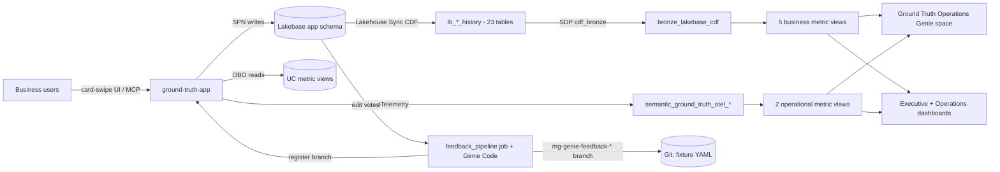

# Semantic Ground Truth App

A crowdsourced validation platform for Unity Catalog semantic assets. Business users review metric view measures, dimensions, UC Pages, Domains, and Subdomains through a Tinder-style card-swipe UX — accessible as a standalone Databricks App and as an MCP App rendered natively in Genie One chat.

Crowdsourced feedback flows through an automated Genie Code pipeline that proposes edits to the source-of-truth YAML fixtures in the owning DAB repo, closing the loop from business validation back to governed code.

## Architecture

The system consists of **9 components** deployed across **3 Declarative Automation Bundles**:

| Bundle | Directory | Components |
|--------|-----------|------------|
| **Infra** | `ground-truth-infra/` | C1 Asset Registry (Lakebase), C6 Feedback Pipeline (Lakeflow Jobs + Genie Code) |
| **App** | `ground-truth-app/` | C2 Review Engine, C3 Card UI (React), C4 MCP Server, C5 Campaign Manager, C7 Notification Service, C8 Executive Dashboard |
| **Agent** | `ground-truth-agent/` | C9 Operational Genie Agent (metric views over Lakebase CDF) |

Deploy order: **infra → app → agent**. The agent depends on metric views built from app data, so deploy it after the data plane is populated.

### Data Flow



### Jobs and pipelines

| Bundle | Job / pipeline | Purpose |
| --- | --- | --- |
| infra | `setup_lakebase_cdf` | Lakehouse Sync for every `app` table (`lb_*_history`) |
| infra | `cdf_bronze` (SDP) + `cdf_bronze_refresh` | Bronze from all history tables; hourly refresh (paused in dev) |
| infra | `metric_view_deploy` | Deploys the 7 metric view fixtures |
| infra | `feedback_pipeline` | Daily: unprocessed edit votes -> Genie Code task (skill `ground-truth-feedback-author`) -> `mg-genie-feedback-<yyyymmdd>` branch -> app registers it for steward review |
| infra | `post_deploy_setup` | After every infra deploy: Genie Code automation, job params (restores the feedback `genie_task`), CDF config |
| infra | `freshness_resurfacing`, `post_deploy_validation` | Daily freshness campaign; infra checks |
| app | `deploy_verification` | M2M probes of the deployed app |
| app | `api_contract_tests` | Live contract run of all 50 routes and 13 MCP tools -> `api_contract_results` |
| app | `sync_agent_skills` | Mirrors `ground-truth-app/agent_skills/` into the `agent_skills` UC volume |
| app | `app_post_deploy_setup`, `create_mcp_connection`, `demo_campaign_seed` | Grants, Unity Gateway connection, demo data |
| agent | `agent_verification` | Genie space + operations dashboard checks |

### Repository Layout

```
semanticGroundTruth/
├── deploy.sh                 # Cross-bundle deploy (resolves infra outputs → app/agent --var)
├── PROJECT_MEMORY.md         # Solution-wide decisions, findings, status log
├── ground-truth-infra/       # Bundle 1 — UC schema, warehouse, Lakebase, CDF, SDP bronze, metric views, jobs
├── ground-truth-app/         # Bundle 2 — AppKit Node.js + React app, MCP server, migrations, app jobs
├── ground-truth-agent/       # Bundle 3 — Ground Truth Operations Genie space, operations dashboard, verification job
├── docs/
│   ├── design/               # L100 / L200 / L300 design documents
│   ├── plans/                # Root build manifest (waves.json), per-session plans, build conventions
│   ├── runbooks/             # Cross-bundle operational runbooks
│   ├── sessions/             # Cross-bundle session summaries + INDEX.md
│   ├── research/ semantics/ pitch/ diagrams/
└── .build-status/            # Per-run session status files written by genie-build-waves
```

### Technology Stack

- **Backend:** Node.js (Databricks AppKit)
- **Frontend:** React with framer-motion card-swipe UX
- **Database:** Lakebase (Postgres) — app state; CDF replicates to Delta for analytics
- **Auth:** Hybrid OBO (user reads) + Service Principal (app writes)
- **Confidence scoring:** Wilson score interval with configurable industry standard prior
- **MCP:** Streamable HTTP via `@modelcontextprotocol/server` v2; Unity Gateway MCP Service
- **Observability:** OpenTelemetry → UC tables (logs, metrics, spans) + MLflow 3 experiment for agent traces
- **Compliance:** HIPAA (AWS us-east-1)

## Design Documents

All design artifacts are in `docs/`:

| Layer | Path | Description |
|-------|------|-------------|
| L100 | `docs/design/L100_semantic_ground_truth_app.md` | System-level constitution |
| L200 | `docs/design/L200-C[1-9]_*.md` | Component designs (9 documents) |
| L300 | `docs/design/L300-[01-17]_*.md` | Implementation specs (17 documents; L300-17 = MCP App review card) |
| UI | `docs/design/ui/` | Screen inventory, UI test strategy, Figma Make brief, build-5 outline |
| Research | `docs/research/` | UC Semantics API surface, Wilson score + Lakebase CDF, Genie Code workflow tasks, DAB secrets/job_runs/MCP, Slack MCP notifications — see [INDEX](docs/research/INDEX.md) |
| Semantics | `docs/semantics/` | Core terminology definitions |
| Pitch | `docs/pitch/` | Customer pitch, SOW timing estimates, HIPAA compliance matrix |
| Diagrams | `docs/diagrams/` | 13 diagrams (Mermaid source + SVG + interactive HTML) |
| Build plans | `docs/plans/` | `waves.json` manifest, session plans (01–15 root build, 16–24 brand + gaps build, 25–41 build 4), `build_conventions.md`, [gap analysis](docs/plans/gap_analysis_2026-10.md), [UI brand plan](docs/plans/ui_brand_plan.md) |
| Runbooks | `docs/runbooks/` | [Deploy order and permissions](docs/runbooks/deploy_order_and_permissions.md), [Onboarding users](docs/runbooks/onboarding_users.md), [CDF → bronze operations](docs/runbooks/cdf_bronze_operations.md), [Feedback pipeline](docs/runbooks/feedback_pipeline.md), [Contract tests](docs/runbooks/contract_tests.md), [Node toolchain in Genie Code](docs/runbooks/node_toolchain_genie_code.md), [UI theming](docs/runbooks/ui_theming.md) |
| Sessions | `docs/sessions/` | Session summaries — see [INDEX](docs/sessions/INDEX.md) |

## Getting Started

Each bundle is an independent Declarative Automation Bundle with its own `databricks.yml`. The solution-root `deploy.sh` deploys them in order and passes infra outputs (warehouse, Lakebase branch/database, MLflow experiment, job IDs) to the app as `--var` values.

### Prerequisites

* Databricks CLI ≥ 0.294.0, authenticated (`databricks auth login`)
* `python3` (JSON parsing in `deploy.sh`)
* Node.js 22+ and pnpm 11+ (app local development only)

### End-to-end deploy (fresh environment)

```bash
# 1. Infra: schema, warehouse, Lakebase, secret scope, M2M SPN, jobs, pipeline, metric view fixtures
./deploy.sh --target dev --infra --run-setup

# 2. App: deploys the app (migrations 001–009 create the Lakebase `app` schema),
#    creates the MCP connection, and registers the MCP service
./deploy.sh --target dev --app

# 3. Data plane (from ground-truth-infra/): Lakebase CDF → bronze → metric views
databricks bundle run setup_lakebase_cdf --target dev
databricks bundle run cdf_bronze --target dev
databricks bundle run metric_view_deploy --target dev

# 4. App verification, live contract tests, optional demo data (from ground-truth-app/)
databricks bundle run deploy_verification --target dev
databricks bundle run api_contract_tests --target dev
databricks bundle run demo_campaign_seed --target dev

# 5. Agent: deploys ground-truth-agent with infra-resolved vars and runs agent_verification
./deploy.sh --target dev --agent --verify
```

Other `deploy.sh` modes: `--validate` (validate only), `--verify` (run each deployed bundle's verification job), `--destroy`. Run `bundle validate --strict` in any bundle after changing YAML.

Before the first deploy, read [Deploy order and permissions](docs/runbooks/deploy_order_and_permissions.md): the deployer needs `MANAGE` on the catalog (app OTel `TABLE` resources), infra must exist before the app (agent skills volume), and unattended runs must ship app code with `bundle run app`, not `bundle deploy`. For the feedback loop, create a dedicated Git folder for `feedback_pipeline` and run `post_deploy_setup` after each infra deploy ([Feedback pipeline](docs/runbooks/feedback_pipeline.md)).

### What deploy.sh wires between bundles

* **App SPN → secret scope ACL.** The infra secret scope's `permissions` block is authoritative, so it must list the app service principal or every infra deploy removes the app's READ. `deploy.sh` resolves the live app SPN with `databricks apps get` and passes `--var app_service_principal_id=<id>` to the infra deploy. On a first deploy (no app yet) it uses the target default, then re-deploys infra after the app exists.
* **Executive dashboard URL → app.** `deploy.sh` reads the `executive` dashboard ID from the infra bundle summary, builds `<workspace>/dashboardsv3/<id>/published` and passes `--var exec_dashboard_url=<url>` to the app. `resources/app.app.yml` `config.env` sets `GT_EXEC_DASHBOARD_URL`, and the app serves it at `GET /api/config`.
* **Bronze refresh.** Infra job `cdf_bronze_refresh` runs the `cdf_bronze` pipeline every hour (UTC). Development mode pauses the schedule in `dev`, so run it there with `databricks bundle run cdf_bronze_refresh --target dev` (from `ground-truth-infra/`).

### UI theme

The app uses the Databricks brand: Lava/Navy/Oat tokens in light and dark mode (`next-themes`, class-based), self-hosted DM Sans and DM Mono, and WCAG 2.1 AA contrast checked by a unit test. See the [UI theming runbook](docs/runbooks/ui_theming.md).

> **Adding new Lakebase tables:** they must have `REPLICA IDENTITY FULL` and an entry in `ground-truth-infra/fixtures/pipelines/cdf_bronze_tables.yaml`. See the [CDF → bronze runbook](docs/runbooks/cdf_bronze_operations.md).

### Access and roles

App roles live in Lakebase app groups (`semantic-ground-truth-admins`, `semantic-ground-truth-stewards`), not workspace SCIM groups. The M2M service principal is bootstrapped as admin through `GT_BOOTSTRAP_ADMIN_IDS`. Add users with the Admin → Members page or `/api/admin/groups/:name/members`. See [Onboarding users](docs/runbooks/onboarding_users.md).

## Building with genie-build-waves

This solution was built and converged with the `genie-build-waves` framework: parallel Genie Code sessions run per wave, an integrator commits each wave, and a gate checks static and runtime health before the next wave starts.

| Item | Location |
| --- | --- |
| Manifest | [`docs/plans/waves.json`](docs/plans/waves.json) — current: build 4, waves 4-0..4-9 / sessions 25–41 (earlier builds' manifests are in git history) |
| Session plans | `docs/plans/NN_*.md` + [`INDEX.md`](docs/plans/INDEX.md) |
| Conventions | [`docs/plans/build_conventions.md`](docs/plans/build_conventions.md) |
| Status files | `.build-status/<run_id>/<session>.json` |
| Build summary | [`docs/sessions/2026-10-23_root-build-waves-summary.md`](docs/sessions/2026-10-23_root-build-waves-summary.md) (root build); brand + gaps build run `745271774924215` in [`docs/sessions/INDEX.md`](docs/sessions/INDEX.md); [build 4 summary](docs/sessions/2026-10-26_build-4-summary.md) |

Runtime gates scan the app's OTel logs. Lines that every redeploy prints (`App did not respect SIGTERM timeout`, `[ELIFECYCLE] Command failed`) are listed in `ignore_patterns` so they don't count as errors.

## Targets

| Target | Catalog | Mode |
|--------|---------|------|
| `dev` | `hls_fde_dev` | Development (default) |
| `prod` | `prod_ground_truth` | Production |

> **Note:** L300-01 originally proposed `dev_ground_truth` as the dev catalog. Actual workspace convention uses `hls_fde_dev`. DAB dev mode auto-prefixes schema names with `dev_<user>_`.

## Current Status

| Bundle | Status | Branch |
|--------|--------|--------|
| **Infra** (Bundle 1) | ✅ **Deployed to dev** — CDF configured, bronze pipeline (23 flows) + hourly `cdf_bronze_refresh` job, 7 metric views with skip measures, executive dashboard (11 datasets), feedback pipeline as a Genie Code task, `agent_skills` volume | `mg-genie-build-4` |
| **App** (Bundle 2) | ✅ **Deployed to dev** — skips (not votes), user settings, steward triage APIs, 50 contract routes, 13 MCP tools + MCP App review card, in-process + live contract tests | `mg-genie-build-4` |
| **Agent** (Bundle 3) | ✅ **Deployed to dev** — Genie space with 9 data sources, operations dashboard (17 datasets), verification 29/29 | `mg-genie-build-4` |

All bundles deployed and converged in `hls_fde_dev.dev_matthew_giglia_semantic_ground_truth` (as of 2026-10-23, build run `713417549836954`, 6/6 waves passed). Key resources:

* **App:** `dev-semantic-ground-truth` (Node.js AppKit + React + MCP Server). Migrations 001–009 applied. Build 4: deployment `01f1d180ccfa147db429fdda372aea06`, 8/8 probes, 932 vitest tests, live contract run `687515436484443` 147 pass / 0 fail / 100% coverage.
* **Data plane:** Lakebase CDF (23 `lb_*_history` tables) → `bronze_lakebase_cdf` → 7 metric views
* **Agent:** `[dev matthew_giglia] Ground Truth Operations` Genie space (9 data sources, 9/9 example SQLs pass EXPLAIN, verification 11/11)
* **Dashboards:** executive `01f1cf0b38d31b7cbac5bdac6cafe3eb` (infra), operations `01f1d17bf9531f5ba79f838a0da0df35` (agent)
* **Jobs / pipeline:** see [Jobs and pipelines](#jobs-and-pipelines)

**Brand + gaps build (run `745271774924215`, 2026-10-23/24):** gaps G1, G2, G3, G7, G8, G9, G17 Done (G7 after post-build brand-asset commits); G6 Partial. Executive dashboard `01f1cf0b38d31b7cbac5bdac6cafe3eb` (9/9 datasets execute). App stable on deployment `01f1cf13577d1d66a5fb26679855e41d` with all 6 probes (`/health`, `/api/me`, `/api/campaigns`, `/api/config`, `/fonts/dm-sans-regular.ttf`, `/mcp`). Details: [gap analysis §5](docs/plans/gap_analysis_2026-10.md).

**Build 4 (runs `110489694161084` + `655172288447819`, 2026-10-24/27, `BUILD_PASSED`):** G4, G9, G10, G17 Done; G6 backend done (UI in build 5); G11 partial (operations dashboard); G5 researched. Details: [gap analysis §6](docs/plans/gap_analysis_2026-10.md), the [build 4 summary](docs/sessions/2026-10-26_build-4-summary.md) and the [unblock and close session](docs/sessions/2026-10-27_build-4-unblock-and-close.md).

**Known follow-ups:** tracked in [`docs/plans/requests/`](docs/plans/requests/README.md) ([build 4 follow-ups](docs/plans/requests/2026-10-27_build-4-follow-ups.md): idempotent `post_deploy_setup` automation, automatic `post_deploy_setup` after infra deploys, build-waves repair of blocked sessions, readable dashboard ids, then build 5 UI). The first feedback branch `mg-genie-feedback-20261026` is a test and can be rejected. The feedback pipeline needs the dedicated Git folder `/Workspace/Users/<you>/semanticGroundTruth-feedback` (job default `repo_path`). `prod` targets are scaffolded but not deployed.

## License

See [LICENSE](LICENSE).
