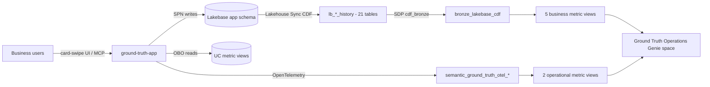

# Semantic Ground Truth App

A crowdsourced validation platform for Unity Catalog semantic assets. Business users review metric view measures, dimensions, UC Pages, Domains, and Subdomains through a Tinder-style card-swipe UX — accessible as a standalone Databricks App and as an MCP App rendered natively in Genie One chat.

Crowdsourced feedback flows through an automated Genie Code pipeline that proposes edits to the source-of-truth YAML fixtures in the owning DAB repo, closing the loop from business validation back to governed code.

## Architecture

The system consists of **9 components** deployed across **3 Declarative Automation Bundles**:

| Bundle | Directory | Components |
|--------|-----------|------------|
| **Infra** | `ground-truth-infra/` | C1 Asset Registry (Lakebase), C6 Feedback Pipeline (Lakeflow Jobs + Genie Code) |
| **App** | `ground-truth-app/` | C2 Review Engine, C3 Card UI (React), C4 MCP Server, C5 Campaign Manager, C7 Notification Service, C8 Executive Dashboard |
| **Agent** | `ground-truth-agent/` | C9 Operational Genie Agent (metric views over Lakebase CDF) |

Deploy order: **infra → app → agent**. The agent depends on metric views built from app data, so deploy it after the data plane is populated.

### Data Flow



### Repository Layout

```
semanticGroundTruth/
├── deploy.sh                 # Cross-bundle deploy (resolves infra outputs → app/agent --var)
├── PROJECT_MEMORY.md         # Solution-wide decisions, findings, status log
├── ground-truth-infra/       # Bundle 1 — UC schema, warehouse, Lakebase, CDF, SDP bronze, metric views, jobs
├── ground-truth-app/         # Bundle 2 — AppKit Node.js + React app, MCP server, migrations, app jobs
├── ground-truth-agent/       # Bundle 3 — Ground Truth Operations Genie space + verification job
├── docs/
│   ├── design/               # L100 / L200 / L300 design documents
│   ├── plans/                # Root build manifest (waves.json), per-session plans, build conventions
│   ├── runbooks/             # Cross-bundle operational runbooks
│   ├── sessions/             # Cross-bundle session summaries + INDEX.md
│   ├── research/ semantics/ pitch/ diagrams/
└── .build-status/            # Per-run session status files written by genie-build-waves
```

### Technology Stack

- **Backend:** Node.js (Databricks AppKit)
- **Frontend:** React with framer-motion card-swipe UX
- **Database:** Lakebase (Postgres) — app state; CDF replicates to Delta for analytics
- **Auth:** Hybrid OBO (user reads) + Service Principal (app writes)
- **Confidence scoring:** Wilson score interval with configurable industry standard prior
- **MCP:** Streamable HTTP via `@modelcontextprotocol/server` v2; Unity Gateway MCP Service
- **Observability:** OpenTelemetry → UC tables (logs, metrics, spans) + MLflow 3 experiment for agent traces
- **Compliance:** HIPAA (AWS us-east-1)

## Design Documents

All design artifacts are in `docs/`:

| Layer | Path | Description |
|-------|------|-------------|
| L100 | `docs/design/L100_semantic_ground_truth_app.md` | System-level constitution |
| L200 | `docs/design/L200-C[1-9]_*.md` | Component designs (9 documents) |
| L300 | `docs/design/L300-[01-16]_*.md` | Implementation specs (16 documents) |
| Research | `docs/research/` | UC Semantics API surface, Wilson score + Lakebase CDF, Genie Code workflow tasks, DAB secrets/job_runs/MCP |
| Semantics | `docs/semantics/` | Core terminology definitions |
| Pitch | `docs/pitch/` | Customer pitch, SOW timing estimates, HIPAA compliance matrix |
| Diagrams | `docs/diagrams/` | 13 diagrams (Mermaid source + SVG + interactive HTML) |
| Build plans | `docs/plans/` | `waves.json` manifest, 15 session plans, `build_conventions.md` |
| Runbooks | `docs/runbooks/` | [Onboarding users](docs/runbooks/onboarding_users.md), [CDF → bronze operations](docs/runbooks/cdf_bronze_operations.md) |
| Sessions | `docs/sessions/` | Session summaries — see [INDEX](docs/sessions/INDEX.md) |

## Getting Started

Each bundle is an independent Declarative Automation Bundle with its own `databricks.yml`. The solution-root `deploy.sh` deploys them in order and passes infra outputs (warehouse, Lakebase branch/database, MLflow experiment, job IDs) to the app as `--var` values.

### Prerequisites

* Databricks CLI ≥ 0.294.0, authenticated (`databricks auth login`)
* `python3` (JSON parsing in `deploy.sh`)
* Node.js 22+ and pnpm 11+ (app local development only)

### End-to-end deploy (fresh environment)

```bash
# 1. Infra: schema, warehouse, Lakebase, secret scope, M2M SPN, jobs, pipeline, metric view fixtures
./deploy.sh --target dev --infra --run-setup

# 2. App: deploys the app (migrations 001–008 create the Lakebase `app` schema),
#    creates the MCP connection, and registers the MCP service
./deploy.sh --target dev --app

# 3. Data plane (from ground-truth-infra/): Lakebase CDF → bronze → metric views
databricks bundle run setup_lakebase_cdf --target dev
databricks bundle run cdf_bronze --target dev
databricks bundle run metric_view_deploy --target dev

# 4. App verification + optional demo data (from ground-truth-app/)
databricks bundle run deploy_verification --target dev
databricks bundle run demo_campaign_seed --target dev

# 5. Agent (from ground-truth-agent/). deploy.sh --agent is still a stub, so deploy directly
databricks bundle deploy --target dev
databricks bundle run agent_verification --target dev
```

Other `deploy.sh` modes: `--validate` (validate only), `--destroy`. Run `bundle validate --strict` in any bundle after changing YAML.

> **Adding new Lakebase tables:** they must have `REPLICA IDENTITY FULL` and an entry in `ground-truth-infra/fixtures/pipelines/cdf_bronze_tables.yaml`. See the [CDF → bronze runbook](docs/runbooks/cdf_bronze_operations.md).

### Access and roles

App roles live in Lakebase app groups (`semantic-ground-truth-admins`, `semantic-ground-truth-stewards`), not workspace SCIM groups. The M2M service principal is bootstrapped as admin through `GT_BOOTSTRAP_ADMIN_IDS`. Add users with the Admin → Members page or `/api/admin/groups/:name/members`. See [Onboarding users](docs/runbooks/onboarding_users.md).

## Building with genie-build-waves

This solution was built and converged with the `genie-build-waves` framework: parallel Genie Code sessions run per wave, an integrator commits each wave, and a gate checks static and runtime health before the next wave starts.

| Item | Location |
| --- | --- |
| Manifest | [`docs/plans/waves.json`](docs/plans/waves.json) — 6 waves / 15 sessions across all three bundles |
| Session plans | `docs/plans/NN_*.md` + [`INDEX.md`](docs/plans/INDEX.md) |
| Conventions | [`docs/plans/build_conventions.md`](docs/plans/build_conventions.md) |
| Status files | `.build-status/<run_id>/<session>.json` |
| Build summary | [`docs/sessions/2026-10-23_root-build-waves-summary.md`](docs/sessions/2026-10-23_root-build-waves-summary.md) |

Runtime gates scan the app's OTel logs. Lines that every redeploy prints (`App did not respect SIGTERM timeout`, `[ELIFECYCLE] Command failed`) are listed in `ignore_patterns` so they don't count as errors.

## Targets

| Target | Catalog | Mode |
|--------|---------|------|
| `dev` | `hls_fde_dev` | Development (default) |
| `prod` | `prod_ground_truth` | Production |

> **Note:** L300-01 originally proposed `dev_ground_truth` as the dev catalog. Actual workspace convention uses `hls_fde_dev`. DAB dev mode auto-prefixes schema names with `dev_<user>_`.

## Current Status

| Bundle | Status | Branch |
|--------|--------|--------|
| **Infra** (Bundle 1) | ✅ **Deployed to dev** — CDF configured, bronze pipeline running (21 flows), 7 metric views deployed | `mg-genie-agent-build` |
| **App** (Bundle 2) | ✅ **Deployed to dev** — RBAC, asset import, MCP server, demo campaign seeded | `mg-genie-agent-build` |
| **Agent** (Bundle 3) | ✅ **Deployed to dev** — Genie space with 9 data sources, verification passing | `mg-genie-agent-build` |

All bundles deployed and converged in `hls_fde_dev.dev_matthew_giglia_semantic_ground_truth` (as of 2026-10-23, build run `713417549836954`, 6/6 waves passed). Key resources:

* **App:** `dev-semantic-ground-truth` (Node.js AppKit + React + MCP Server). Migrations 001–008 applied. `/health`, `/api/me`, `/api/campaigns` and `/mcp` probes pass. Runtime gate passed a 10-minute soak with 0 errors.
* **Data plane:** Lakebase CDF (21 `lb_*_history` tables) → `bronze_lakebase_cdf` (281 rows, 13 sources at converge time) → 7 metric views
* **Agent:** `[dev matthew_giglia] Ground Truth Operations` Genie space (9 data sources, 9/9 example SQLs pass EXPLAIN, verification 11/11)
* **Jobs / pipeline:** infra `setup_lakebase_cdf`, `cdf_bronze` (SDP), `metric_view_deploy`, `post_deploy_validation`, `feedback_pipeline`, `freshness_resurfacing`; app `deploy_verification`, `demo_campaign_seed`, `app_post_deploy_setup`, `create_mcp_connection`; agent `agent_verification`

**Known follow-ups:** wire Phase 3 (`--agent`) in `deploy.sh`, graceful SIGTERM shutdown in `ground-truth-app/server/server.ts`, and a gate `error_pattern` for structured `"level":"error"` request logs. `prod` targets are scaffolded but not deployed.

## License

See [LICENSE](LICENSE).
