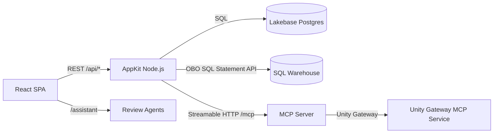

# Semantic Ground Truth App

A crowdsourced review platform for Unity Catalog semantic assets — metric view measures and dimensions, Pages, Domains, and Subdomains. Business users vote on definition quality through a card-swipe interface; confidence scores converge via Wilson score intervals. Built on [Databricks AppKit](https://developers.databricks.com/docs/appkit/v0/).

> **Bundle 2 of 3** in the `semanticGroundTruth` monorepo. Deploy [ground-truth-infra](../ground-truth-infra/) first.

## Architecture



| Component | Description |
| --- | --- |
| **Review Engine** | Wilson score confidence, weighted-random surfacing, gamification |
| **Campaign Manager** | Automatic, manual, and freshness campaigns with RBAC scope |
| **Notification Service** | In-app inbox; Slack/Teams/webhook when env vars set |
| **MCP Server** | 12 tools via Streamable HTTP, registered in Unity Gateway |
| **Agents** | review-assistant (markdown, default) + review-worker (code, read-only tools) |
| **Card UI** | framer-motion drag, keyboard shortcuts, accessible buttons |

## Project Structure

```
ground-truth-app/
├── databricks.yml              # Bundle config (app + MCP service resources)
├── app.yaml                    # App runtime config
├── appkit.plugins.json         # Plugin manifest
├── package.json                # pnpm monorepo root
├── pnpm-workspace.yaml
├── tsconfig.json / .client / .server / .shared
├── server/
│   ├── server.ts               # AppKit entry (plugins, migrations, services, routes, MCP)
│   ├── lib/                    # db, errors, http, context, config, events, databricks, logger, deps
│   ├── migrations/             # Idempotent runner + migrations 001-008 (007 app groups/sources/CDF, 008 votes.version_hash)
│   ├── middleware/             # Identity (x-forwarded-*), roles, request logging
│   ├── services/
│   │   ├── asset/              # AssetRegistry (Lakebase CRUD)
│   │   ├── metricView/         # MetricViewService (OBO SQL Statement API)
│   │   ├── review/             # ReviewEngine (Wilson score, surfacing, leaderboard)
│   │   ├── campaign/           # CampaignManager (lifecycle, scope, RBAC)
│   │   ├── notification/       # NotificationService (inbox, digest, destinations)
│   │   ├── membership/         # MembershipService (Lakebase app groups → roles, bootstrap admins)
│   │   ├── sources/            # SourceService, glossary parser, workspace file reader (OBO + M2M)
│   │   └── index.ts            # createServices / getServices singleton
│   ├── routes/                 # REST handlers (see Route Table below)
│   ├── mcp/                    # Streamable HTTP MCP server (12 tools)
│   ├── seed/                   # Dev seed (12 sample assets)
│   └── agents/
│       ├── review-assistant/   # Markdown agent (default)
│       ├── review-worker/      # Code agent (6 read-only tools)
│       └── (skills load from the agent_skills UC volume; sources in ../agent_skills/)
├── client/
│   └── src/
│       ├── App.tsx             # Router: /, /leaderboard, /steward, /admin, /executive, /assistant
│       ├── main.tsx            # QueryClientProvider
│       ├── lib/api/            # Typed fetch client + React Query hooks
│       ├── components/
│       │   ├── layout/         # AppLayout, NavLinks, NotificationBell
│       │   ├── review/         # CardStack, ReviewCard, SwipeActions, EditSheet, ...
│       │   ├── leaderboard/    # LeaderboardTable, MyStatsCard, BadgeList
│       │   ├── steward/        # CampaignList, CreateCampaignSheet, AssetBrowser, ImportWizard, ...
│       │   ├── admin/          # ScoringConfigForm, RoleListsForm, MaintenanceActions, MembersPanel, ...
│       │   └── executive/      # KpiCards, DashboardLink
│       └── pages/              # ReviewPage, LeaderboardPage, StewardPage, AdminPage, ExecutivePage
├── shared/
│   └── contracts/              # Domain types, zod schemas, API DTOs, MCP tool shapes, error codes
└── config/
    ├── queries/                # SQL query files
    └── metric-views/           # Metric view definitions
```

## Route Table

| Method | Path | Role | Purpose |
| --- | --- | --- | --- |
| GET | `/health` | — | Health check (DB + migration count) |
| GET | `/api/me` | reviewer | Current user context |
| GET | `/api/config` | reviewer | Runtime config: `executive_dashboard_url` (from `GT_EXEC_DASHBOARD_URL`) |
| GET | `/api/review/next` | reviewer | Next review card (campaign/type filter) |
| POST | `/api/review/vote` | reviewer | Submit vote (approve/reject/edit/skip) |
| POST | `/api/review/synonym` | reviewer | Add/vote/remove synonym |
| POST | `/api/review/example` | reviewer | Add/vote example question |
| POST | `/api/review/run-query` | reviewer | Execute validation query (OBO) |
| GET | `/api/review/stats/me` | reviewer | Personal stats + streak |
| GET | `/api/leaderboard` | reviewer | Ranked reviewers (7d/30d/all) |
| GET | `/api/assets` | reviewer | Paged asset list |
| GET | `/api/assets/:assetId` | reviewer | Asset detail |
| GET | `/api/assets/:assetId/versions` | reviewer | Asset version history |
| POST | `/api/assets/register` | steward | Register/re-register asset |
| POST | `/api/assets/import` | steward | Bulk import assets from metric views or a registered source |
| GET | `/api/sources` | steward | List registered asset sources |
| POST | `/api/sources` | steward | Register a source (UC schema or workspace glossary path) |
| POST | `/api/sources/:id/scan` | steward | Scan a source for importable assets |
| GET | `/api/catalog/catalogs` | steward | Browse UC catalogs (OBO) |
| GET | `/api/catalog/schemas` | steward | Browse schemas in a catalog (OBO) |
| GET | `/api/catalog/metric-views` | steward | Browse metric views in a schema (OBO) |
| GET | `/api/campaigns` | reviewer | List campaigns (RBAC-filtered) |
| POST | `/api/campaigns` | steward | Create campaign |
| GET | `/api/campaigns/:campaignId` | reviewer | Campaign detail |
| PATCH | `/api/campaigns/:campaignId/status` | steward | Transition campaign status |
| POST | `/api/campaigns/freshness-check` | admin | Trigger freshness resurfacing |
| GET | `/api/notifications` | reviewer | Notification inbox |
| GET | `/api/notifications/unread-count` | reviewer | Unread badge count |
| POST | `/api/notifications/read` | reviewer | Mark notifications read |
| GET | `/api/notifications/preferences` | reviewer | Notification preferences |
| PUT | `/api/notifications/preferences` | reviewer | Update preferences |
| GET | `/api/admin/config` | admin | App scoring/role config |
| PUT | `/api/admin/config` | admin | Update config |
| GET | `/api/admin/summary` | steward | Executive coverage summary |
| POST | `/api/admin/recompute/:assetId` | admin | Recompute confidence score |
| GET | `/api/admin/groups` | admin | List app groups + members |
| POST | `/api/admin/groups/:name/members` | admin | Add a member to an app group |
| DELETE | `/api/admin/groups/:name/members/:memberId` | admin | Remove a member from an app group |
| GET | `/api/metric-views` | reviewer | List metric views (OBO) |
| GET | `/api/metric-views/:fullName` | reviewer | Metric view detail (OBO) |
| POST | `/api/metric-views/:fullName/validate` | reviewer | Validate metric view (OBO) |
| POST | `/mcp` | — | MCP Streamable HTTP endpoint |

Full route details in [plan 09](docs/plans/09_rest_routes_wiring.md).

## MCP Tools

Registered in Unity Gateway as `semantic-ground-truth-mcp`. 12 tools across three domains:

| Domain | Tools |
| --- | --- |
| Review | `review_get_next`, `review_submit_vote`, `review_add_synonym`, `review_add_example`, `review_get_stats`, `review_run_query` |
| Campaign | `campaign_list`, `campaign_create`, `campaign_update_status` |
| Metric View | `metric_view_list`, `metric_view_get`, `metric_view_validate` |

## Roles

| Role | Who | How to grant |
| --- | --- | --- |
| `reviewer` | All authenticated users | Automatic (any user with `CAN_USE`) |
| `steward` | Data stewards | Member of `semantic-ground-truth-stewards` app group |
| `admin` | App administrators | Member of `semantic-ground-truth-admins` app group |

Roles are stored in Lakebase app groups (`app.app_groups` + `app.app_group_members`), not workspace SCIM groups. `admin` implies `steward`. See [Onboarding Users](../docs/runbooks/onboarding_users.md).

## Environment Variables

### Platform-injected (via `app.yaml` resource bindings)

| Variable | Source |
| --- | --- |
| `DATABRICKS_SERVING_ENDPOINT_NAME` | agents serving endpoint |
| `MLFLOW_EXPERIMENT_ID` | MLflow experiment for agent traces |
| `DATABRICKS_WAREHOUSE_ID` | SQL warehouse for OBO queries |
| `DATABRICKS_JOB_ID` | Freshness resurfacing job |
| `LAKEBASE_ENDPOINT` | Lakebase Postgres connection |
| `OTEL_TRACES_SAMPLER` | `always_on` (record every trace) |

### Application (set in `app.yaml`, `.env`, or Admin UI)

| Variable | Default | Purpose |
| --- | --- | --- |
| `DATABRICKS_HOST` | Platform-set | Workspace URL |
| `DEV_USER_EMAIL` | `local-dev@example.com` | Fallback identity in local dev |
| `SEED_SAMPLE_ASSETS` | `false` | Seed 12 sample assets on startup |
| `GT_BOOTSTRAP_ADMIN_IDS` | `valueFrom: m2m-client-id` | Principal IDs always granted admin (M2M SPN client ID from the secret resource) |
| `GT_ADMIN_EMAILS` | — | Legacy comma-separated admin emails, merged with app groups (prefer app groups) |
| `GT_STEWARD_EMAILS` | — | Legacy comma-separated steward emails, merged with app groups |
| `GT_METRIC_VIEW_CATALOG` | — | Catalog for metric view reads |
| `GT_METRIC_VIEW_SCHEMA` | — | Schema for metric view reads |
| `SLACK_WEBHOOK_URL` | — | Slack notification destination (optional) |
| `TEAMS_WEBHOOK_URL` | — | Teams notification destination (optional) |
| `GENERIC_WEBHOOK_URL` | — | Generic webhook destination (optional) |
| `GT_EXEC_DASHBOARD_URL` | `""` | Published URL of the executive AI/BI dashboard, served at runtime by `GET /api/config` (`executive_dashboard_url`; `null` unless it is an `https://` URL). Set by `resources/app.app.yml` `config.env` from the bundle variable `exec_dashboard_url`; `app.yaml` keeps an empty fallback. Replaces the build-time `VITE_EXEC_DASHBOARD_URL`. |

## Bundle Variables and Targets

| Target | Mode | App Name |
| --- | --- | --- |
| `dev` (default) | development | `dev-semantic-ground-truth` |
| `prod` | production | `semantic-ground-truth` |
| `local` | localhost proxy | — (`http://127.0.0.1:7073`) |

Key bundle variables: `app_display_name`, `agents_serving_endpoint_name`, `agents_mlflow_experiment_experimentId`, `sql_warehouse_id`, `job_id`, `postgres_branch`, `postgres_database`, `catalog`, `schema_name`, `mcp_execute_principal`, `secret_scope_name` (default `semantic_ground_truth_credentials`; backs the `m2m-client-id` secret resource), `exec_dashboard_url` (default `""`). Values for `dev` are injected from infra via `deploy.sh --var`; `deploy.sh` builds `exec_dashboard_url` from the infra `executive` dashboard ID.

> **Secret scope READ for the app SPN** is declared in the infra bundle (`app_service_principal_id`), because the infra scope `permissions` block is authoritative. `app_post_deploy_setup` (`grant_app_permissions`) also re-grants READ as a safety net, and `deploy_verification` fails if the ACL is missing.

## Prerequisites

- Node.js v22+ and pnpm 11+
- Databricks CLI (v0.294.0+ for telemetry export)
- Access to the target Databricks workspace
- **ground-truth-infra** bundle deployed (provides Lakebase, UC schema, SQL warehouse, secrets)

## Local Development

```bash
cp .env.example .env
# Edit .env with your workspace URL and resource IDs
pnpm install
pnpm run dev
```

The dev server starts at the port shown in console output. The `local` target in `databricks.yml` has all variables hardcoded for `http://127.0.0.1:7073`.

## Bundle Jobs

| Job | Resource Key | Purpose |
|---|---|---|
| Deploy Verification | `deploy_verification` | M2M OAuth probe: `/health`, `/api/me`, `/api/campaigns`, `/mcp`, secret scope ACL lists the app SPN, `/api/config` returns `null` or an `https://` URL |
| Demo Campaign Seed | `demo_campaign_seed` | Grants, import from metric views, create campaign, cast votes, verify leaderboard |
| App Post-Deploy Setup | `app_post_deploy_setup` | `CAN_USE` grants for users group + UC grants for M2M SPN + app SPN READ on the secret scope (idempotent) |
| Create MCP Connection | `create_mcp_connection` | Schema-level HTTP connection for Unity Gateway |

## Deploy

First deploy requires the infra bundle and a multi-step verification. See [First Deploy Verification Runbook](docs/runbooks/first-deploy-verification.md).

Subsequent deploys:

```bash
# From the monorepo root, using the cross-bundle deploy script:
./deploy.sh --target dev --app

# Or directly:
databricks bundle deploy --target dev
databricks bundle run app --target dev
```

> **Restarting a stopped app:** `databricks apps start <APP_NAME>`.

> **Secret resource before plain `apps deploy`:** `GT_BOOTSTRAP_ADMIN_IDS` reads the `m2m-client-id` app resource. Run `bundle deploy` at least once so the resource is attached before using `databricks apps deploy` directly.

After deploying, run `databricks bundle run deploy_verification --target dev`. On a fresh environment, optionally run `demo_campaign_seed`.

> **Executive dashboard link:** deploy with `./deploy.sh --target dev --app` so `exec_dashboard_url` is filled in. A direct `bundle deploy` without `--var exec_dashboard_url=<url>` leaves it empty, and the Executive page shows "Executive dashboard URL not configured" with an admin hint.

## Code Quality

```bash
pnpm run typecheck    # TypeScript strict check (tsc -b)
pnpm run lint         # ESLint
pnpm run lint:fix
pnpm run format       # Prettier
pnpm run format:fix
pnpm test             # vitest
```

The Apps build runs the tests too: `prebuild` ends with `vitest run`, so a failing test fails the deploy. `vitest.config.ts` excludes `**/.venv/**` (the Apps container has a Python venv with unrelated tests).

## UI Theme and Accessibility

Databricks brand tokens (Lava, Navy, Oat) in light and dark mode. `next-themes` puts a `.dark` class on `<html>`, and the header toggle cycles light / dark / system. DM Sans and DM Mono are self-hosted in `client/public/fonts/`. The light primary is Lava 700 (decision D1, for WCAG contrast); Lava 600 is the brand accent.

* Hex values: `client/src/theme/tokens.ts`. CSS variables: `client/src/index.css` (`:root` and `.dark`).
* Tests: `client/src/theme/contrast.test.ts` (WCAG contrast pairings), `client/src/theme/a11y-static.test.ts` (no Tailwind palette classes, labelled buttons, focus rings), `server/mcp/views/cardHtml.test.ts` (MCP card light/dark).
* Review flow: ← reject, → approve, ↑ edit, S skip, with a live region. `LogicView` shows plain English and the definition (DM Mono) on each card.

How to add a component with tokens: [UI theming runbook](../docs/runbooks/ui_theming.md).

## Tech Stack

| Layer | Technology |
| --- | --- |
| Runtime | Node.js (AppKit v0.84.0) |
| Package manager | pnpm 11 |
| Language | TypeScript 5.9 (strict) |
| Server | Express (via AppKit `server()` plugin) |
| Client | React 19, Vite, Tailwind CSS 4, react-router 7 |
| Data queries | React Query v5 (`@tanstack/react-query`) |
| Animations | framer-motion (card-swipe drag) |
| MCP | `@modelcontextprotocol/sdk` (Streamable HTTP) |
| Database | Lakebase (Postgres) — schema `app` |
| Validation | zod v4 |
| Testing | vitest |
| UI components | `@databricks/appkit-ui` + lucide-react icons |

## Observability

OpenTelemetry signals are exported to Unity Catalog tables via `telemetry_export_destinations` in `databricks.yml`:

| Signal | Table |
| --- | --- |
| Logs | `semantic_ground_truth_otel_logs` |
| Metrics | `semantic_ground_truth_otel_metrics` |
| Traces | `semantic_ground_truth_otel_spans` |

Agent traces are logged to MLflow experiment `app_agents_experiment`.

## Design Documents

Full architecture and component designs live in `../docs/design/`:

- **L100** — System constitution (9 components)
- **L200-C1..C9** — Component designs (Asset Registry through Operational Agent)
- **L300-09..L300-13** — Implementation specs for this bundle

Build plans: [docs/plans/INDEX.md](docs/plans/INDEX.md) · Session summaries: [docs/sessions/](docs/sessions/)
