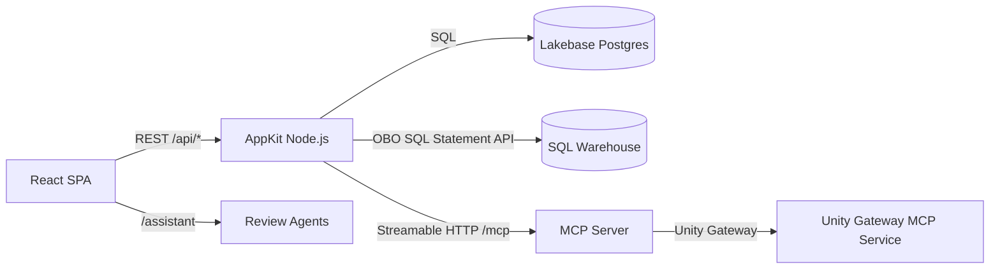

# Semantic Ground Truth App

A crowdsourced review platform for Unity Catalog semantic assets — metric view measures and dimensions, Pages, Domains, and Subdomains. Business users vote on definition quality through a card-swipe interface; confidence scores converge via Wilson score intervals. Built on [Databricks AppKit](https://developers.databricks.com/docs/appkit/v0/).

> **Bundle 2 of 3** in the `semanticGroundTruth` monorepo. Deploy [ground-truth-infra](../ground-truth-infra/) first.

## Architecture



| Component | Description |
| --- | --- |
| **Review Engine** | Wilson score confidence, weighted-random surfacing, gamification |
| **Campaign Manager** | Automatic, manual, and freshness campaigns with RBAC scope |
| **Notification Service** | In-app inbox; Slack/Teams/webhook when env vars set |
| **Skips + settings** | A skip is not a vote (`app.review_skips`, cooldown, reason); per-user settings (`app.user_settings`) |
| **Steward triage APIs** | Feedback queue, edit conflicts, feedback branches from the feedback pipeline (UI in build 5) |
| **MCP Server** | 13 contract-validated tools via Streamable HTTP, MCP App review card, registered in Unity Gateway |
| **Agents** | review-assistant (markdown, default) + review-worker (code, read-only tools) |
| **Card UI** | framer-motion drag, keyboard shortcuts, accessible buttons |

## Project Structure

```
ground-truth-app/
├── databricks.yml              # Bundle config (app + MCP service resources)
├── app.yaml                    # Comment stub; runtime config is resources/app.app.yml config
├── appkit.plugins.json         # Plugin manifest
├── package.json                # pnpm monorepo root
├── pnpm-workspace.yaml
├── tsconfig.json / .client / .server / .shared
├── server/
│   ├── server.ts               # AppKit entry (plugins, migrations, services, routes, MCP)
│   ├── lib/                    # db, errors, http, context, config, events, databricks, logger, deps
│   ├── migrations/             # Idempotent runner + migrations 001-009 (007 app groups/sources/CDF, 008 votes.version_hash, 009 skips/settings/steward triage)
│   ├── middleware/             # Identity (x-forwarded-*), roles, request logging
│   ├── services/
│   │   ├── asset/              # AssetRegistry (Lakebase CRUD)
│   │   ├── metricView/         # MetricViewService (OBO SQL Statement API)
│   │   ├── review/             # ReviewEngine (Wilson score, surfacing, leaderboard)
│   │   ├── campaign/           # CampaignManager (lifecycle, scope, RBAC)
│   │   ├── notification/       # NotificationService (inbox, digest, destinations)
│   │   ├── membership/         # MembershipService (Lakebase app groups → roles, bootstrap admins)
│   │   ├── sources/            # SourceService, glossary parser, workspace file reader (OBO + M2M)
│   │   ├── settings/           # SettingsService (app.user_settings)
│   │   ├── steward/            # StewardService (feedback queue, conflicts, feedback branches)
│   │   └── index.ts            # createServices / getServices singleton
│   ├── routes/                 # REST handlers (see Route Table below)
│   ├── mcp/                    # Streamable HTTP MCP server (13 tools in tools/, views/ = markdown + MCP App card)
│   ├── seed/                   # Dev seed (12 sample assets)
│   └── agents/
│       ├── review-assistant/   # Markdown agent (default)
│       ├── review-worker/      # Code agent (6 read-only tools)
│       └── (skills load from the agent_skills UC volume; sources in ../agent_skills/)
├── client/
│   └── src/
│       ├── App.tsx             # Router: /, /leaderboard, /steward, /admin, /executive, /assistant
│       ├── main.tsx            # QueryClientProvider
│       ├── lib/api/            # Typed fetch client + React Query hooks
│       ├── components/
│       │   ├── layout/         # AppLayout, NavLinks, NotificationBell
│       │   ├── review/         # CardStack, ReviewCard, SwipeActions, EditSheet, ...
│       │   ├── leaderboard/    # LeaderboardTable, MyStatsCard, BadgeList
│       │   ├── steward/        # CampaignList, CreateCampaignSheet, AssetBrowser, ImportWizard, ...
│       │   ├── admin/          # ScoringConfigForm, RoleListsForm, MaintenanceActions, MembersPanel, ...
│       │   └── executive/      # KpiCards, DashboardLink
│       └── pages/              # ReviewPage, LeaderboardPage, StewardPage, AdminPage, ExecutivePage
├── shared/
│   └── contracts/              # Domain types, zod schemas, ROUTE_CONTRACTS (50), MCP_TOOL_CONTRACTS (13), error codes; generated/contracts.schema.json
├── tests/contract/             # In-process contract suite + manifest.json (see Testing)
├── agent_skills/               # review-guide, scoring-model, tracer-bullets (synced to the agent_skills UC volume)
├── resources/                  # app.app.yml, MCP service, jobs/
└── config/
    ├── queries/                # SQL query files
    └── metric-views/           # Metric view definitions
```

## Route Table

Generated from `ROUTE_CONTRACTS` (`tests/contract/manifest.json`, 50 routes: `GET /health` + 49 under `/api`). "Success" is the contract success status; "Errors" are the contract error statuses, each covered by a contract test case. Every route validates params/query/body with the contract zod schemas (400 `VALIDATION`).

| Method | Path | Role | Success | Errors | Purpose |
| --- | --- | --- | --- | --- | --- |
| GET | `/health` | public | 200 | 500 | Health check: `{status, db, migrations, version}` |
| GET | `/api/config` | reviewer | 200 | 401, 403, 500 | Runtime config: `executive_dashboard_url` (from `GT_EXEC_DASHBOARD_URL`) |
| GET | `/api/me` | reviewer | 200 | 401, 403, 500 | Current user context |
| GET | `/api/review/next` | reviewer | 200 | 400, 401, 403, 404, 500 | Next review card (campaign/type filter) |
| POST | `/api/review/vote` | reviewer | 200 | 400, 401, 403, 404, 500 | Submit vote (approve/reject/edit; `skip` is rejected with 400) |
| POST | `/api/review/synonym` | reviewer | 200 | 400, 401, 403, 404, 500 | Add/vote/remove synonym |
| POST | `/api/review/example` | reviewer | 200 | 400, 401, 403, 404, 500 | Add/vote example question |
| POST | `/api/review/run-query` | reviewer | 200 | 400, 401, 403, 404, 500, 502 | Execute validation query (OBO) |
| GET | `/api/review/stats/me` | reviewer | 200 | 401, 403, 500 | Personal stats + streak |
| GET | `/api/leaderboard` | reviewer | 200 | 400, 401, 403, 500 | Ranked reviewers (7d/30d/all) |
| GET | `/api/assets` | reviewer | 200 | 400, 401, 403, 500 | Paged asset list |
| GET | `/api/assets/:assetId` | reviewer | 200 | 400, 401, 403, 404, 500 | Asset detail |
| GET | `/api/assets/:assetId/versions` | reviewer | 200 | 400, 401, 403, 404, 500 | Asset version history |
| POST | `/api/assets/register` | steward | 201 | 400, 401, 403, 500 | Register/re-register asset |
| POST | `/api/assets/import` | steward | 200 | 400, 401, 403, 404, 500, 502 | Bulk import assets from metric views or a registered source |
| GET | `/api/sources` | steward | 200 | 401, 403, 500 | List registered asset sources |
| POST | `/api/sources` | steward | 201 | 400, 401, 403, 409, 500, 502 | Register a source (UC schema or workspace glossary path) |
| POST | `/api/sources/:id/scan` | steward | 200 | 400, 401, 403, 404, 500, 502 | Scan a source for importable assets |
| GET | `/api/campaigns` | reviewer | 200 | 400, 401, 403, 500 | List campaigns (RBAC-filtered) |
| POST | `/api/campaigns` | steward | 201 | 400, 401, 403, 500 | Create campaign |
| GET | `/api/campaigns/:campaignId` | reviewer | 200 | 400, 401, 403, 404, 500 | Campaign detail |
| PATCH | `/api/campaigns/:campaignId/status` | steward | 200 | 400, 401, 403, 404, 409, 500 | Transition campaign status |
| POST | `/api/campaigns/freshness-check` | admin | 200 | 401, 403, 500 | Trigger freshness resurfacing |
| GET | `/api/catalog/catalogs` | steward | 200 | 401, 403, 500, 502 | Browse UC catalogs (OBO) |
| GET | `/api/catalog/schemas` | steward | 200 | 400, 401, 403, 404, 500, 502 | Browse schemas in a catalog (OBO) |
| GET | `/api/catalog/metric-views` | steward | 200 | 400, 401, 403, 404, 500, 502 | Browse metric views in a schema (OBO) |
| GET | `/api/metric-views` | reviewer | 200 | 400, 401, 403, 404, 500, 502 | List metric views (OBO) |
| GET | `/api/metric-views/:fullName` | reviewer | 200 | 400, 401, 403, 404, 500, 502 | Metric view detail (OBO) |
| POST | `/api/metric-views/:fullName/validate` | reviewer | 200 | 400, 401, 403, 404, 500, 502 | Validate metric view (OBO) |
| GET | `/api/notifications` | reviewer | 200 | 400, 401, 403, 500 | Notification inbox |
| GET | `/api/notifications/unread-count` | reviewer | 200 | 401, 403, 500 | Unread badge count |
| POST | `/api/notifications/read` | reviewer | 200 | 400, 401, 403, 500 | Mark notifications read |
| GET | `/api/notifications/preferences` | reviewer | 200 | 401, 403, 500 | Notification preferences |
| PUT | `/api/notifications/preferences` | reviewer | 200 | 400, 401, 403, 500 | Update preferences |
| GET | `/api/admin/config` | admin | 200 | 401, 403, 500 | App scoring/role config |
| PUT | `/api/admin/config` | admin | 200 | 400, 401, 403, 500 | Update config |
| GET | `/api/admin/summary` | steward | 200 | 401, 403, 500 | Executive coverage summary |
| POST | `/api/admin/recompute/:assetId` | admin | 200 | 400, 401, 403, 404, 500 | Recompute confidence score |
| GET | `/api/admin/groups` | admin | 200 | 401, 403, 500 | List app groups + members |
| POST | `/api/admin/groups/:name/members` | admin | 200 | 400, 401, 403, 404, 500 | Add a member to an app group |
| DELETE | `/api/admin/groups/:name/members/:memberId` | admin | 200 | 400, 401, 403, 404, 409, 500 | Remove a member from an app group |
| POST | `/api/review/skip` | reviewer | 201 | 400, 401, 403, 404, 500 | Skip the current card (not a vote; cooldown, reason) |
| GET | `/api/me/settings` | reviewer | 200 | 401, 403, 500 | Current user settings (migration defaults when unset) |
| PUT | `/api/me/settings` | reviewer | 200 | 400, 401, 403, 404, 500 | Partial update of user settings |
| GET | `/api/steward/feedback-queue` | steward | 200 | 400, 401, 403, 500 | Votes grouped by asset with pending edits and skips |
| GET | `/api/steward/conflicts` | steward | 200 | 400, 401, 403, 500 | Assets with conflicting edit proposals |
| POST | `/api/steward/conflicts/:assetId/resolve` | steward | 200 | 400, 401, 403, 404, 409, 500 | Resolve a conflict (`accept_edit` / `keep_current` / `reject_all`; 409 on a stale view) |
| GET | `/api/steward/feedback-branches` | steward | 200 | 400, 401, 403, 500 | List `mg-genie-feedback-*` branches registered by the feedback pipeline |
| POST | `/api/steward/feedback-branches` | admin | 201 | 400, 401, 403, 404, 500 | Register/upsert a feedback branch (feedback pipeline; `voteIds` marked processed) |
| POST | `/api/steward/feedback-branches/:batchId/status` | steward | 200 | 400, 401, 403, 404, 409, 500 | Set branch review status (`in_review` / `merged` / `rejected`) |
| POST | `/mcp` | — | — | — | MCP Streamable HTTP endpoint (not in `ROUTE_CONTRACTS`; covered by `MCP_TOOL_CONTRACTS`) |

Regenerate this table when `ROUTE_CONTRACTS` changes (`pnpm exec tsx tests/contract/generate-manifest.ts > tests/contract/manifest.json`). Session plans for all routes are listed in [`../docs/plans/INDEX.md`](../docs/plans/INDEX.md); build-4 routes are in [plan 33](../docs/plans/33_app_server_skip_settings_steward_api.md).

## MCP Tools

Registered in Unity Gateway as `semantic-ground-truth-mcp`. 13 tools, all registered from `MCP_TOOL_CONTRACTS` with `registerContractTool` (`server/mcp/tools/define.ts`): the contract input is the tool's `inputSchema`, and the output is checked before it is returned as `structuredContent` (always an object; lists are `{ items: [...] }`). Every tool also returns a text `content` fallback.

| Tool | Role | Review card UI |
| --- | --- | --- |
| `review_get_next` | reviewer | yes |
| `review_submit_vote` | reviewer | yes |
| `review_add_synonym` | reviewer | — |
| `review_add_example` | reviewer | — |
| `review_get_stats` | reviewer | yes |
| `review_run_query` | reviewer | — |
| `campaign_list` | reviewer | — |
| `campaign_create` | steward | — |
| `campaign_update_status` | steward | — |
| `metric_view_list` | reviewer | — |
| `metric_view_get` | reviewer | — |
| `metric_view_validate` | reviewer | — |
| `review_skip_card` | reviewer | yes |

**MCP App review card** (build 4): resource `ui://ground-truth/review-card`, MIME `text/html;profile=mcp-app` (`@modelcontextprotocol/ext-apps` 1.7.5), a self-contained card with Approve / Reject / Edit / Skip and keyboard shortcuts A/R/E/S. Hosts without MCP Apps get the markdown text. Design: [L300-17](../docs/design/L300-17_mcp_app_review_card.md).

## Roles

| Role | Who | How to grant |
| --- | --- | --- |
| `reviewer` | All authenticated users | Automatic (any user with `CAN_USE`) |
| `steward` | Data stewards | Member of `semantic-ground-truth-stewards` app group |
| `admin` | App administrators | Member of `semantic-ground-truth-admins` app group |

Roles are stored in Lakebase app groups (`app.app_groups` + `app.app_group_members`), not workspace SCIM groups. `admin` implies `steward`. See [Onboarding Users](../docs/runbooks/onboarding_users.md).

## Environment Variables

All runtime env is set in `resources/app.app.yml` `config.env` (that block replaces `app.yaml`, which is a comment stub).

### Platform-injected (via `config.env` `value_from` resource bindings)

| Variable | Source |
| --- | --- |
| `DATABRICKS_SERVING_ENDPOINT_NAME` | agents serving endpoint |
| `MLFLOW_EXPERIMENT_ID` | MLflow experiment for agent traces |
| `DATABRICKS_WAREHOUSE_ID` | SQL warehouse for OBO queries |
| `DATABRICKS_JOB_ID` | Freshness resurfacing job |
| `LAKEBASE_ENDPOINT` | Lakebase Postgres connection |
| `OTEL_TRACES_SAMPLER` | `always_on` (record every trace) |

### Application (set in `resources/app.app.yml` `config.env`, a local `.env`, or Admin UI)

| Variable | Default | Purpose |
| --- | --- | --- |
| `DATABRICKS_HOST` | Platform-set | Workspace URL |
| `DEV_USER_EMAIL` | `local-dev@example.com` | Fallback identity in local dev |
| `SEED_SAMPLE_ASSETS` | `false` | Seed 12 sample assets on startup |
| `GT_BOOTSTRAP_ADMIN_IDS` | `valueFrom: m2m-client-id` | Principal IDs always granted admin (M2M SPN client ID from the secret resource) |
| `GT_ADMIN_EMAILS` | — | Legacy comma-separated admin emails, merged with app groups (prefer app groups) |
| `GT_STEWARD_EMAILS` | — | Legacy comma-separated steward emails, merged with app groups |
| `GT_METRIC_VIEW_CATALOG` | — | Catalog for metric view reads |
| `GT_METRIC_VIEW_SCHEMA` | — | Schema for metric view reads |
| `SLACK_WEBHOOK_URL` | — | Slack notification destination (optional) |
| `TEAMS_WEBHOOK_URL` | — | Teams notification destination (optional) |
| `GENERIC_WEBHOOK_URL` | — | Generic webhook destination (optional) |
| `GT_EXEC_DASHBOARD_URL` | `""` | Published URL of the executive AI/BI dashboard, served at runtime by `GET /api/config` (`executive_dashboard_url`; `null` unless it is an `https://` URL). Set by `resources/app.app.yml` `config.env` from the bundle variable `exec_dashboard_url`. Replaces the build-time `VITE_EXEC_DASHBOARD_URL`. |

## Bundle Variables and Targets

| Target | Mode | App Name |
| --- | --- | --- |
| `dev` (default) | development | `dev-semantic-ground-truth` |
| `prod` | production | `semantic-ground-truth` |
| `local` | localhost proxy | — (`http://127.0.0.1:7073`) |

Key bundle variables: `app_display_name`, `agents_serving_endpoint_name`, `agents_mlflow_experiment_experimentId`, `sql_warehouse_id`, `job_id`, `postgres_branch`, `postgres_database`, `catalog`, `schema_name`, `mcp_execute_principal`, `secret_scope_name` (default `semantic_ground_truth_credentials`; backs the `m2m-client-id` secret resource), `exec_dashboard_url` (default `""`). Values for `dev` are injected from infra via `deploy.sh --var`; `deploy.sh` builds `exec_dashboard_url` from the infra `executive` dashboard ID.

> **Secret scope READ for the app SPN** is declared in the infra bundle (`app_service_principal_id`), because the infra scope `permissions` block is authoritative. `app_post_deploy_setup` (`grant_app_permissions`) also re-grants READ as a safety net, and `deploy_verification` fails if the ACL is missing.

## Prerequisites

- Node.js v22+ and pnpm 11+
- Databricks CLI (v0.294.0+ for telemetry export)
- Access to the target Databricks workspace
- **ground-truth-infra** bundle deployed (provides Lakebase, UC schema, SQL warehouse, secrets)

## Local Development

```bash
cp .env.example .env
# Edit .env with your workspace URL and resource IDs
pnpm install
pnpm run dev
```

The dev server starts at the port shown in console output. The `local` target in `databricks.yml` has all variables hardcoded for `http://127.0.0.1:7073`.

## Bundle Jobs

| Job | Resource Key | Purpose |
|---|---|---|
| Deploy Verification | `deploy_verification` | M2M OAuth probe: `/health`, `/api/me`, `/api/campaigns`, `/mcp`, secret scope ACL lists the app SPN, `/api/config` returns `null` or an `https://` URL |
| Demo Campaign Seed | `demo_campaign_seed` | Grants, import from metric views, create campaign, cast votes, verify leaderboard |
| App Post-Deploy Setup | `app_post_deploy_setup` | `CAN_USE` grants for users group + UC grants for M2M SPN + app SPN READ on the secret scope (idempotent) |
| Create MCP Connection | `create_mcp_connection` | Schema-level HTTP connection for Unity Gateway |
| API Contract Tests | `api_contract_tests` | Live contract run of every route and MCP tool in `tests/contract/manifest.json` as the M2M SPN; writes `api_contract_results`, fails on any `fail` or coverage < 100% |
| Sync Agent Skills | `sync_agent_skills` | Mirrors `agent_skills/` into the infra `agent_skills` volume; triggered by `run_sync_agent_skills` when a skill file changes |

## Deploy

First deploy requires the infra bundle and a multi-step verification. See [First Deploy Verification Runbook](docs/runbooks/first-deploy-verification.md).

Subsequent deploys:

```bash
# From the monorepo root, using the cross-bundle deploy script:
./deploy.sh --target dev --app

# Or directly:
databricks bundle deploy --target dev
databricks bundle run app --target dev
```

> **Unattended deploys:** from a scheduled Genie Code task or job, `bundle deploy` fails at `apps update` with `Invalid delegation claim present in Ctx`. Use `bundle run app --target dev` to ship code there; apply config changes from an interactive session. Do not use a plain `databricks apps deploy` (it builds with `NODE_ENV=production` and the client tests fail). See [Deploy order and permissions](../docs/runbooks/deploy_order_and_permissions.md).

> **Restarting a stopped app:** `databricks apps start <APP_NAME>`.

> **Secret resource before plain `apps deploy`:** `GT_BOOTSTRAP_ADMIN_IDS` reads the `m2m-client-id` app resource. Run `bundle deploy` at least once so the resource is attached before using `databricks apps deploy` directly.

After deploying, run `databricks bundle run deploy_verification --target dev`. On a fresh environment, optionally run `demo_campaign_seed`.

> **Executive dashboard link:** deploy with `./deploy.sh --target dev --app` so `exec_dashboard_url` is filled in. A direct `bundle deploy` without `--var exec_dashboard_url=<url>` leaves it empty, and the Executive page shows "Executive dashboard URL not configured" with an admin hint.

## Code Quality

```bash
pnpm run typecheck    # TypeScript strict check (tsc -b)
pnpm run lint         # ESLint
pnpm run lint:fix
pnpm run format       # Prettier
pnpm run format:fix
pnpm test             # vitest
```

The Apps build runs the tests too: `prebuild` ends with `vitest run`, so a failing test fails the deploy. `vitest.config.ts` excludes `**/.venv/**` (the Apps container has a Python venv with unrelated tests), defines two projects (`node` for server/shared/tests, `client` with `jsdom`), and sets `silent: 'passed-only'` so passing error-path tests do not print error logs in the build.

## Testing

| Layer | What | How |
| --- | --- | --- |
| Unit + component | vitest `node` and `client` projects (932 tests after build 4) | `pnpm test` |
| Contract (in-process) | `tests/contract/**`: every `ROUTE_CONTRACTS` route (success + each error status), all 13 MCP tools, coverage test, invariants | Part of `pnpm test` |
| Contract (live) | `api_contract_tests` job against the deployed app | `databricks bundle run api_contract_tests --target dev`, then query `api_contract_results` |

When you add a route or tool: add the contract, add cases in `tests/contract/routeCases.ts` or `toolCases.ts`, and regenerate `tests/contract/manifest.json` and `shared/contracts/generated/contracts.schema.json`. The coverage test fails until you do. Details: [Contract tests runbook](../docs/runbooks/contract_tests.md). Running Node/pnpm inside a Genie Code task: [Node toolchain runbook](../docs/runbooks/node_toolchain_genie_code.md).

## UI Theme and Accessibility

Databricks brand tokens (Lava, Navy, Oat) in light and dark mode. `next-themes` puts a `.dark` class on `<html>`, and the header toggle cycles light / dark / system. DM Sans and DM Mono are self-hosted in `client/public/fonts/`. The light primary is Lava 700 (decision D1, for WCAG contrast); Lava 600 is the brand accent.

* Hex values: `client/src/theme/tokens.ts`. CSS variables: `client/src/index.css` (`:root` and `.dark`).
* Tests: `client/src/theme/contrast.test.ts` (WCAG contrast pairings), `client/src/theme/a11y-static.test.ts` (no Tailwind palette classes, labelled buttons, focus rings), `server/mcp/views/cardHtml.test.ts` (MCP card light/dark).
* Review flow: ← reject, → approve, ↑ edit, S skip, with a live region. `LogicView` shows plain English and the definition (DM Mono) on each card.

How to add a component with tokens: [UI theming runbook](../docs/runbooks/ui_theming.md).

## Tech Stack

| Layer | Technology |
| --- | --- |
| Runtime | Node.js (AppKit v0.84.0) |
| Package manager | pnpm 11 |
| Language | TypeScript 5.9 (strict) |
| Server | Express (via AppKit `server()` plugin) |
| Client | React 19, Vite, Tailwind CSS 4, react-router 7 |
| Data queries | React Query v5 (`@tanstack/react-query`) |
| Animations | framer-motion (card-swipe drag) |
| MCP | `@modelcontextprotocol/sdk` (Streamable HTTP), `@modelcontextprotocol/ext-apps` 1.7.5 (MCP App card) |
| Database | Lakebase (Postgres) — schema `app` |
| Validation | zod v4 |
| Testing | vitest 4, Testing Library, jsdom, vitest-axe |
| UI components | `@databricks/appkit-ui` + lucide-react icons |

## Observability

OpenTelemetry signals are exported to Unity Catalog tables via `telemetry_export_destinations` in `databricks.yml`. The app also declares the three tables as `uc_securable` `TABLE` resources (`MODIFY`), which grants the app SPN `USE CATALOG` / `USE SCHEMA`; the deployer needs `MANAGE` on the catalog.

| Signal | Table |
| --- | --- |
| Logs | `semantic_ground_truth_otel_logs` |
| Metrics | `semantic_ground_truth_otel_metrics` |
| Traces | `semantic_ground_truth_otel_spans` |

Agent traces are logged to MLflow experiment `app_agents_experiment`.

## Design Documents

Full architecture and component designs live in `../docs/design/`:

- **L100** — System constitution (9 components)
- **L200-C1..C9** — Component designs (Asset Registry through Operational Agent)
- **L300-09..L300-13** — Implementation specs for this bundle

Build plans: [../docs/plans/INDEX.md](../docs/plans/INDEX.md) · Session summaries: [docs/sessions/](docs/sessions/)
